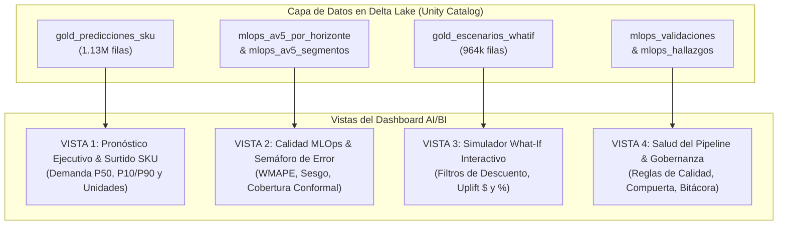

# Consultas SQL Maestras: Dashboard AI/BI en Azure Databricks

**Proyecto Integrador MNA · Tecnológico de Monterrey & Bnext**  
**Equipo 43:** Daniela Juárez · Kevin Valdez · Yael Márquez  
**Catálogo:** `modeladoprescriptivoventas` | **Esquema:** `maestria`  
**Entorno de Ejecución:** Databricks SQL Warehouse (Serverless) / AI/BI Dashboards  

---

## 📌 Arquitectura de las 4 Vistas del Dashboard



---

## 🟢 VISTA 1: Pronóstico Ejecutivo y Surtido a Nivel SKU

### Query 1.1: Tarjetas Ejecutivas de KPI (Resumen a 14 Días)
* **Propósito:** Mostrar los 4 números macro en la cabecera del tablero.
* **Visualización:** Tarjetas de Contador (*Counter / Metric Cards*).

```sql
-- KPI CARDS: Resumen del horizonte a 14 días
SELECT 
  ROUND(SUM(prediccion_sku_p50), 0) AS venta_total_proyectada_mxn,
  ROUND(SUM(p90_sku), 0) AS techo_seguridad_p90_mxn,
  SUM(surtido_sugerido_unidades_p90) AS unidades_totales_surtido_p90,
  COUNT(DISTINCT tienda) AS tiendas_activas,
  COUNT(DISTINCT producto_id) AS skus_lideres_abastecidos
FROM modeladoprescriptivoventas.maestria.gold_predicciones_sku
WHERE run_id = (SELECT MAX(run_id) FROM modeladoprescriptivoventas.maestria.gold_predicciones_sku);
```

---

### Query 1.2: Curva Temporal de Demanda con Banda Conformal [P10 - P90]
* **Propósito:** Visualizar la evolución diaria del pronóstico central P50 acotado por el piso P10 y techo de seguridad P90.
* **Visualización:** Gráfico de Líneas con Relleno de Área (*Line Chart with Confidence Band*).
  * Eje X: `fecha_objetivo`
  * Eje Y: `demanda_central_p50`, `piso_p10`, `techo_p90`

```sql
-- CURVA DE DEMANDA DIARIA CON BANDA CONFORMAL P10 - P90
SELECT 
  fecha_objetivo,
  h,
  DATE_FORMAT(fecha_objetivo, 'E') AS dia_semana,
  ROUND(SUM(p10_sku), 2) AS piso_conservador_p10,
  ROUND(SUM(prediccion_sku_p50), 2) AS demanda_central_p50,
  ROUND(SUM(p90_sku), 2) AS techo_seguridad_p90,
  SUM(surtido_sugerido_unidades_p90) AS unidades_sugeridas_p90
FROM modeladoprescriptivoventas.maestria.gold_predicciones_sku
WHERE run_id = (SELECT MAX(run_id) FROM modeladoprescriptivoventas.maestria.gold_predicciones_sku)
  AND (:region_param IS NULL OR region = :region_param)
  AND (:categoria_param IS NULL OR categoria_id = :categoria_param)
GROUP BY fecha_objetivo, h, DATE_FORMAT(fecha_objetivo, 'E')
ORDER BY fecha_objetivo ASC;
```

---

### Query 1.3: Tabla de Surtido Operativo por SKU (Guía para Compras y Tiendas)
* **Propósito:** Lista descargable de pedidos por producto líder, con unidades recomendadas y share de venta.
* **Visualización:** Tabla Detallada con Búsqueda (*Detailed Table*).

```sql
-- GUÍA DE PEDIDO Y REABASTECIMIENTO POR PRODUCTO LÍDER (SKU)
SELECT 
  producto_id,
  COALESCE(nombre_categoria, categoria_id) AS categoria,
  region,
  ROUND(AVG(share_venta) * 100, 2) AS share_venta_pct,
  ROUND(AVG(precio_medio_estimado), 2) AS precio_unitario_promedio,
  ROUND(SUM(prediccion_sku_p50), 2) AS venta_proyectada_p50,
  ROUND(SUM(p90_sku), 2) AS techo_seguridad_p90,
  SUM(surtido_sugerido_unidades_p90) AS unidades_sugeridas_p90
FROM modeladoprescriptivoventas.maestria.gold_predicciones_sku
WHERE run_id = (SELECT MAX(run_id) FROM modeladoprescriptivoventas.maestria.gold_predicciones_sku)
  AND (:region_param IS NULL OR region = :region_param)
  AND (:categoria_param IS NULL OR categoria_id = :categoria_param)
GROUP BY producto_id, COALESCE(nombre_categoria, categoria_id), region
ORDER BY venta_proyectada_p50 DESC
LIMIT 50;
```

---

## 🟡 VISTA 2: Calidad MLOps y Semáforo de Error

### Query 2.1: Rendimiento por Horizonte y Comparativa vs Regla Ingenua
* **Propósito:** Mostrar cómo el modelo bate a la regla actual a lo largo de los 14 días.
* **Visualización:** Gráfico de Doble Línea / Barras (*Clustered Bar or Combo Chart*).

```sql
-- WMAPE POR HORIZONTE: MODELO CAMPEÓN VS LÍNEA BASE
SELECT 
  h,
  ROUND(wmape, 4) AS wmape_modelo_campeon,
  ROUND(wmape_ingenuo, 4) AS wmape_regla_actual,
  ROUND((1.0 - (wmape / wmape_ingenuo)) * 100, 2) AS mejora_relativa_pct,
  ROUND(sesgo_pct, 2) AS sesgo_pct
FROM modeladoprescriptivoventas.maestria.mlops_av5_por_horizonte
WHERE run_id = (SELECT MAX(run_id) FROM modeladoprescriptivoventas.maestria.mlops_av5_por_horizonte)
ORDER BY h ASC;
```

---

### Query 2.2: Semáforo de Rendimiento por Región y Tipología de Categoría
* **Propósito:** Auditoría del WMAPE por zona geográfica y línea comercial (física vs servicios).
* **Visualización:** Gráfico de Barras Horizontales con Color Condicional (*Bar Chart*).

```sql
-- WMAPE Y SESGO POR SEGMENTO GEOGRÁFICO Y COMERCIAL
SELECT 
  tipo_segmento,
  segmento,
  n_filas,
  ROUND(wmape, 4) AS wmape,
  ROUND(wmape_ingenuo, 4) AS wmape_ingenuo,
  ROUND((1.0 - (wmape / wmape_ingenuo)) * 100, 2) AS reduccion_error_pct,
  ROUND(sesgo_pct, 2) AS sesgo_pct,
  CASE 
    WHEN wmape <= 0.4600 THEN 'Verde: Excelente (<0.46)'
    WHEN wmape <= 0.5060 THEN 'Amarillo: Aceptable (<0.506)'
    ELSE 'Rojo: Requiere Atención (>0.506)'
  END AS semaforo_calidad
FROM modeladoprescriptivoventas.maestria.mlops_av5_segmentos
WHERE run_id = (SELECT MAX(run_id) FROM modeladoprescriptivoventas.maestria.mlops_av5_segmentos)
  AND tipo_segmento IN ('region', 'tipo_categoria')
ORDER BY tipo_segmento, wmape ASC;
```

---

### Query 2.3: Calibración y Cobertura Conformal del Intervalo [P10, P90]
* **Propósito:** Verificar que la cobertura real cumpla la garantía estadística nominal del 80% $\pm$ 5 pp.
* **Visualización:** Gráfico de Dispersión / Indicador de Medidor (*Gauge / Bullet Chart*).

```sql
-- COBERTURA EMPÍRICA Y ANCHO DE INTERVALOS CONFORMALES
SELECT 
  metodo,
  ROUND(cobertura * 100, 2) AS cobertura_real_pct,
  80.0 AS cobertura_objetivo_pct,
  ROUND(ancho_relativo_mediano, 2) AS ancho_relativo_mediano,
  ROUND(pinball_loss_medio, 4) AS pinball_loss
FROM modeladoprescriptivoventas.maestria.mlops_av5_cuantiles
WHERE run_id = (SELECT MAX(run_id) FROM modeladoprescriptivoventas.maestria.mlops_av5_cuantiles)
ORDER BY pinball_loss_medio ASC;
```

---

## 🟣 VISTA 3: Simulador Interactivo What-If (Palanca Comercial)

### Query 3.1: Resumen de Impacto Financiero por Escenario de Descuento
* **Propósito:** Comparar el impacto macro de los 4 escenarios de promoción.
* **Visualización:** Gráfico de Columnas Agrupadas con Tarjetas de Uplift.

```sql
-- COMPARADOR MACRO DE ESCENARIOS WHAT-IF
SELECT 
  id_escenario,
  descripcion_escenario,
  ROUND(descuento_planeado * 100, 0) AS descuento_pct,
  ROUND(SUM(venta_base_p50), 0) AS venta_base_total_mxn,
  ROUND(SUM(venta_simulada_p50), 0) AS venta_simulada_total_mxn,
  ROUND(SUM(uplift_pesos), 0) AS incremento_neto_mxn,
  ROUND(AVG(uplift_pct), 2) AS uplift_promedio_pct,
  ROUND(SUM(p90_simulado), 0) AS techo_surtido_p90_simulado_mxn
FROM modeladoprescriptivoventas.maestria.gold_escenarios_whatif
WHERE (:region_param IS NULL OR region = :region_param)
  AND (:categoria_param IS NULL OR categoria_id = :categoria_param)
GROUP BY id_escenario, descripcion_escenario, descuento_planeado
ORDER BY descuento_planeado ASC;
```

---

### Query 3.2: Simulador Sensibilidad por Categoría y Región (Filtro Dinámico)
* **Propósito:** Permitir al usuario seleccionar una categoría y región y ver exactamente cómo cambia la demanda en pesos y el techo P90.
* **Visualización:** Gráfico de Área con Selector de Escenario (`:escenario_param`).

```sql
-- CURVA DE DEMANDA SIMULADA WHAT-IF POR FECHA
SELECT 
  fecha_objetivo,
  h,
  id_escenario,
  descripcion_escenario,
  ROUND(SUM(venta_base_p50), 2) AS demanda_base_p50,
  ROUND(SUM(venta_simulada_p50), 2) AS demanda_simulada_p50,
  ROUND(SUM(uplift_pesos), 2) AS uplift_mxn,
  ROUND(SUM(p10_simulado), 2) AS p10_simulado,
  ROUND(SUM(p90_simulado), 2) AS p90_techo_seguridad
FROM modeladoprescriptivoventas.maestria.gold_escenarios_whatif
WHERE (:escenario_param IS NULL OR id_escenario = :escenario_param)
  AND (:region_param IS NULL OR region = :region_param)
  AND (:categoria_param IS NULL OR categoria_id = :categoria_param)
GROUP BY fecha_objetivo, h, id_escenario, descripcion_escenario
ORDER BY fecha_objetivo ASC;
```

---

### Query 3.3: Top 10 Categorías con Mayor Ganancia Comercial por Promoción
* **Propósito:** Mostrar a la Dirección Comercial qué categorías son más elásticas y generan mayor retorno monetario.
* **Visualización:** Gráfico de Barras de Mayor a Menor (*Tornado / Bar Chart*).

```sql
-- TOP CATEGORÍAS CON MAYOR UPLIFT COMERCIAL ($)
SELECT 
  COALESCE(nombre_categoria, categoria_id) AS categoria,
  tipo_categoria,
  ROUND(SUM(venta_base_p50), 0) AS venta_base,
  ROUND(SUM(venta_simulada_p50), 0) AS venta_con_promo,
  ROUND(SUM(uplift_pesos), 0) AS incremento_ventas_mxn,
  ROUND(AVG(uplift_pct), 1) AS uplift_pct
FROM modeladoprescriptivoventas.maestria.gold_escenarios_whatif
WHERE id_escenario = 'S2_ESTANDAR_20'  -- Evaluación con descuento estándar del 20%
GROUP BY COALESCE(nombre_categoria, categoria_id), tipo_categoria
ORDER BY incremento_ventas_mxn DESC
LIMIT 10;
```

---

## 🔵 VISTA 4: Salud del Pipeline MLOps y Gobernanza

### Query 4.1: Dictamen de la Compuerta Técnica MLOps
* **Propósito:** Certificar el estado de aprobación del modelo en Unity Catalog.
* **Visualización:** Tarjeta de Estado (*Badge / Status Card*).

```sql
-- DICTAMEN DE LA COMPUERTA MLOPS DEL MODELO CAMPEÓN
SELECT 
  modelo AS modelo_evaluado,
  estado_desarrollo,
  CASE WHEN technical_pass = true THEN 'APROBADO (7 de 7 controles)' ELSE 'RECHAZADO' END AS compuerta_tecnica,
  registry_action AS accion_model_registry,
  GET_JSON_OBJECT(detalle_json, '$.scope_metrics.wmape_global') AS wmape_global_certificado,
  GET_JSON_OBJECT(detalle_json, '$.scope_metrics.wmape_mercancia') AS wmape_mercancia_certificado
FROM modeladoprescriptivoventas.maestria.mlops_av5_compuerta
LIMIT 1;
```

---

### Query 4.2: Auditoría de Reglas de Calidad de Datos
* **Propósito:** Demostrar que los datos en Bronce, Plata y Oro pasan los contratos de calidad.
* **Visualización:** Tabla Semáforo de Reglas (*Status Table*).

```sql
-- SEMÁFORO DE REGLAS DE CALIDAD DE DATOS (CONTRATOS)
SELECT 
  regla,
  CASE WHEN estado = 'PASA' THEN '✅ PASA' ELSE '❌ FALLA' END AS estado_validacion,
  CASE WHEN critica = true THEN 'Crítica (Detiene Pipeline)' ELSE 'Informativa' END AS severidad,
  detalle
FROM modeladoprescriptivoventas.maestria.mlops_validaciones
ORDER BY critica DESC, regla ASC;
```

---

### Query 4.3: Bitácora Histórica de Hallazgos y Corridas
* **Propósito:** Registro cronológico de trazabilidad de notebooks ejecutados.
* **Visualización:** Lista de Eventos / Bitácora (*Timeline List*).

```sql
-- BITÁCORA HISTÓRICA DE HALLAZGOS Y EJECUCIONES
SELECT 
  fecha_corrida,
  notebook,
  orden,
  hallazgo
FROM modeladoprescriptivoventas.maestria.mlops_hallazgos
ORDER BY fecha_corrida DESC, orden ASC
LIMIT 40;
```

---

## ⚙️ Parámetros Recomendados en Databricks AI/BI Dashboards

Para hacer el tablero interactivo, configura en el panel de parámetros de Databricks:
1. `:region_param` $\to$ Tipo: *Dropdown Single Select* $\to$ Valores desde consulta: `SELECT DISTINCT region FROM modeladoprescriptivoventas.maestria.silver_catalogo_tiendas WHERE region IS NOT NULL ORDER BY region;`
2. `:categoria_param` $\to$ Tipo: *Dropdown Single Select* $\to$ Valores desde consulta: `SELECT DISTINCT categoria_id, nombre FROM modeladoprescriptivoventas.maestria.silver_catalogo_categorias ORDER BY nombre;`
3. `:escenario_param` $\to$ Tipo: *Dropdown Single Select* $\to$ Valores estáticos: `'S0_BASE', 'S1_TACTICA_10', 'S2_ESTANDAR_20', 'S3_AGRESIVA_30'`.
